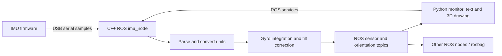

# IMU: from sensor readings to the 3D box

## Architecture



The [C++ ROS node](src/imu_node.cpp) owns the serial device, auto-resume toggle,
sample parsing, publishing and services. Its [filter](include/saprog/imu_filter.hpp)
owns orientation, gyro bias and zero. The [Python monitor](scripts/imu_monitor.py)
only subscribes to ROS messages, draws the scene and calls services. Its quaternion
to angle conversion is for display, not another orientation estimator.

This separates sensor processing from drawing: a slow or closed UI does not slow
the filter or erase the saved reference. The backend does not command the servos.
The existing USB attachment shell helper is OS setup; C++ invokes it asynchronously
under WSL and reports failures through ROS. The backend requires Linux/WSL.

## What each sensor tells you

| Sensor | Measurement | Useful for | Limitation |
| --- | --- | --- | --- |
| Gyroscope | Angular velocity around the sensor's X/Y/Z axes | Following quick rotations | Small errors accumulate; rates beyond the configured range clip |
| Accelerometer | Specific force, including the resting gravity response | Correcting roll and pitch when nearly stationary | Motion acceleration can look like tilt; it cannot determine yaw |
| Magnetometer | Magnetic field vector | Providing a heading reference | Needs axis alignment and calibration; motors, steel and currents can disturb it |

For example, 90 degrees/second sustained for one second is a quarter turn. The
gyro supplies the rate, and the filter accumulates many small rotations using the
sensor timestamp. It stores orientation as a **quaternion**: four numbers describing
a 3D rotation without the singularity of roll/pitch/yaw. Body-axis gyro rates are
not directly interchangeable with changes in Euler angles.

The filter uses the accelerometer to gently bring its estimated vertical back
toward measured gravity. The correction is a rotation about a horizontal axis;
it does not directly apply a heading correction. Magnetic heading is optional
and disabled by default. With it disabled, yaw starts at zero and is relative,
not compass north.

## Why fast movement can leave an error

During a fast movement, the accelerometer measures movement acceleration as well
as gravity. Treating all of that as gravity tilts the estimate toward a false
vertical. In addition, clipped gyro values, sparse samples and missing samples
lose part of the rotation. Software cannot reconstruct an unknown lost turn.

The current filter:

1. Integrates the gyro using sensor time, independently of the UI update rate.
2. Suppresses gravity correction above 45 degrees/second, or when acceleration
   magnitude differs from resting gravity by 8% or more.
3. Waits for 250 ms of acceptable readings before resuming tilt correction.
4. Uses a 0.5-second correction time constant.
5. Reports suspicious timestamp intervals and the largest observed gyro-axis rate.

These are heuristics, not a guarantee that all translation is rejected. A motion
can change the acceleration direction while its magnitude remains near 1 g.
Gravity can help roll/pitch recover after motion; it cannot recover a lost yaw
angle. Turning on an uncalibrated magnetometer is not a reliable fix for that.

The status display now exposes measured sample rate, timestamp-gap count, peak
gyro rate and rejected lines. Gap count is a diagnostic heuristic, not an exact
count of lost packets. Compare peak rate to the device's actual configured gyro
range; this software does not query or change that range. Confirm the serial
format and units before interpreting these numbers as calibrated measurements.

## Zero versus calibration

**Zero orientation** saves the current estimated rotation `q_zero`. The display
uses `inverse(q_zero) * q_current`. At the moment zero is saved, this is the identity
rotation, so the box reads level. Saving zero does not improve sensor accuracy;
if `q_current` drifts, the difference drifts too.

**Calibrate gyro + zero** collects four seconds of stationary data, requiring at
least 20 samples. It averages the gyro readings to estimate the resting bias and
subtracts that bias from subsequent measurements. It also starts the attitude
estimate from the averaged resting acceleration before saving zero. It rejects
obvious motion, noise, bad timing or acceleration far from 1 g. This reduces
resting drift but does not calibrate magnetometer distortion or gyro scale, and
cannot repair clipped fast movement. Steady rotation can be mistaken for bias;
the IMU must actually be still.

The reference and calibration live in the ROS backend. Closing the Python window
preserves them. Reconnecting or restarting the backend resets both. Changing
heading mode clears the reference and restarts the estimate; the gyro bias remains.

## ROS interface

Sensor topics use sensor-data QoS (best effort, small queues). Status is reliable
at 5 Hz. The node is named `/saprog_imu`.

| Topic | Type | Meaning |
| --- | --- | --- |
| `/saprog/imu/data_raw` | `sensor_msgs/msg/Imu` | Uncorrected angular velocity and acceleration in SI units; orientation marked unavailable |
| `/saprog/imu/data` | `sensor_msgs/msg/Imu` | Estimated sensor-to-local-world orientation, bias-corrected gyro and measured acceleration |
| `/saprog/imu/mag` | `sensor_msgs/msg/MagneticField` | Magnetic field in tesla |
| `/saprog/imu/orientation` | `geometry_msgs/msg/QuaternionStamped` | Display rotation relative to saved zero, or the filter's local world when no zero is saved |
| `/saprog/imu/status` | `saprog/msg/ImuStatus` | Connection, calibration, zero, timing diagnostics and available serial ports |
| `/saprog/imu/serial` | `std_msgs/msg/String` | Original serial lines, including rejected lines |

Acceleration is converted from g to m/s², gyro from degrees/s to radians/s and
magnetometer from microtesla to tesla. Acceleration still includes the gravity
response; it is not gravity-subtracted translational acceleration. Covariances
are unknown (all zero); raw orientation covariance starts with -1, indicating
that no raw orientation is supplied. See the official ROS definitions for
[Imu](https://github.com/ros2/common_interfaces/blob/jazzy/sensor_msgs/msg/Imu.msg)
and [MagneticField](https://github.com/ros2/common_interfaces/blob/jazzy/sensor_msgs/msg/MagneticField.msg).

Standard sensor message headers use ROS reception time and `frame_id=imu_link`.
The filter integrates using the device's millisecond timestamp. The zero-relative
quaternion names its reference frame `imu_zero`; without zero it names `imu_world`.
These local reference names do not imply a published TF transform or surveyed ENU
heading. The C++ backend does not estimate position.

All services are under `/saprog/imu/`:

| Service | Type | Result |
| --- | --- | --- |
| `connect` | `saprog/srv/ConnectImu` | Open a specified device/baud, or detect the SparkFun device for an empty path |
| `disconnect` | `std_srvs/srv/Trigger` | Close the serial port and clear orientation/reference |
| `refresh_ports` | `std_srvs/srv/Trigger` | Refresh the backend's serial-port list |
| `toggle_readings` | `std_srvs/srv/Trigger` | Send the firmware's Space pause/resume toggle |
| `zero` / `clear_zero` | `std_srvs/srv/Trigger` | Save or clear the shared reference |
| `calibrate` | `std_srvs/srv/Trigger` | Start calibration; observe completion/rejection on status |
| `use_magnetometer` | `std_srvs/srv/SetBool` | Change heading mode and clear the reference |

## Running it

Home's Robot tab opens an accelerated RViz2 view for the full URDF model. The
`saprog_description` package installs the model and meshes, `robot_state_publisher`
computes the leg transforms from the servo readback, and a small bridge aligns the
base frame with `/saprog/imu/orientation`. RViz2 renders the mesh display with its
OpenGL renderer instead of redrawing individual triangles on the Tk canvas. Start
the view from Home after building and sourcing the workspace. It requires the ROS 2
`rviz2`, `robot_state_publisher`, and `tf2_ros` packages.

Restart Home after source changes so its usual workspace build installs the C++
executable, generated messages/services, launch file and Python window together.
Home starts an independent IMU backend when the IMU tab is first opened. Closing
the tab leaves the backend running; closing Home shuts down the backend it owns.

After the workspace is built and sourced, start ROS and the UI together:

```sh
ros2 launch saprog imu.launch.py
```

Closing that window leaves the ROS launch process running. Stop the launch process
with Ctrl+C when finished. To run without a GUI, then open/close displays separately:

```sh
ros2 launch saprog imu.launch.py gui:=false
ros2 run saprog imu_monitor
```

Use only one IMU backend per physical serial device. Explicit port selection:

```sh
ros2 launch saprog imu.launch.py device:=/dev/ttyACM0 baud_rate:=115200
ros2 topic echo /saprog/imu/status
ros2 topic hz /saprog/imu/data
ros2 service call /saprog/imu/zero std_srvs/srv/Trigger '{}'
ros2 service call /saprog/imu/calibrate std_srvs/srv/Trigger '{}'
```

Connect without automatic startup, for example during commissioning:

```sh
ros2 launch saprog imu.launch.py gui:=false auto_connect:=false
ros2 service call /saprog/imu/connect saprog/srv/ConnectImu "{device: '/dev/ttyACM0', baud_rate: 115200}"
```

Startup parameters on `imu_node` are `device`, `baud_rate`, `frame_id`,
`auto_connect`, `use_magnetometer`, `usb_helper`, `accel_scale`, `gyro_scale`, and
`mag_scale`. Runtime changes use services. Unit scales multiply incoming values
to produce g, degrees/s and microtesla; do not guess raw-count scales because they
depend on the firmware's full-scale settings. WSL uses the existing USB helper;
devices still need to have been shared with usbipd on Windows.

Expected serial format is exactly ten numeric columns:

```text
time_ms, ax, ay, az, gx, gy, gz, mx, my, mz
```

The defaults match SparkFun calculated output. Raw-count mode or different enabled
fields must be configured explicitly; extra/missing/nonfinite columns are rejected.
The firmware's format is configurable, so a successful connection alone does not
prove the parser matches your device. See the
[SparkFun firmware](https://github.com/sparkfun/9DOF_Razor_IMU/blob/v30/Firmware/_9DoF_Razor_M0_Firmware/_9DoF_Razor_M0_Firmware.ino).

## The ground plane and your URDF

The floor, shadow and box height are visual references. They do not show measured
height or robot position. The floor stays fixed; only the box orientation changes.

A URDF describes robot links, joints and their geometry. It does not tell this
filter which way your physical IMU is mounted. Connecting the IMU to the robot's
`base_link` requires the actual mounting rotation/translation in URDF/TF. No
mounting transform is invented by this implementation. Zero is a convenient
display reference, not a substitute for that transform.

## Checks

`imu_filter_test` is a CTest target for strict CSV parsing, rapid rotations with
misleading acceleration, zero invariance, timestamp gaps and stationary bias
calibration/rejection. It does not validate physical sensor units, mounting,
magnetometer calibration or hardware clipping. ROS build and live sensor checks
remain necessary before relying on the estimate for robot control.
